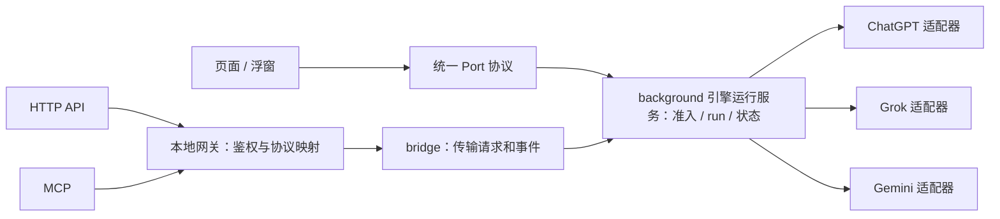

# 统一引擎语义、接口与功能开放

## 设计结论与状态

引擎是 ChatGPTBox 可以统一调用的执行后端。平台适配负责实现操作；页面、
HTTP API 和 MCP 使用这些操作；bridge 传递请求与事件。新增平台适配不应要求
在每个入口重新实现该平台的问答、会话和完成判断。

“适配一次”指平台到 Box 操作的语义映射只维护一份，仍需实现该平台必要的
原生运行时、状态与权限。公共 HTTP/MCP 的协议投影也只开发一次；之后某个
引擎实现了这些操作，开启授权便可复用投影。开关不会生成尚未实现的适配。

用户于 2026-11-12 要求结合 ChatGPT Web、Grok Web、Gemini Web 的现有实现，
设计统一语义、接口、开放规范与收敛方法；随后明确要求实施并验证。
用户于 2026-11-13 明确 API gateway 与 MCP 属于同一权限域，独立 gateway MCP
token 与额外隔离不是需求；实现沿用 API token 和统一的引擎外部授权。
本次已实现公共运行服务、三家适配、API/bridge/MCP 投影、授权迁移和旧接口兼容。
本文拥有已实施的跨引擎语义、接口和功能开放规则；具体代码布局由
[架构](../ARCHITECTURE.md)管理，[API](api-server.md)、[MCP](mcp-server.md)
和 [Gemini](gemini-web.md)管理使用步骤与原生限制。
[实施与审阅证据](evidence/2026-11-12-engine-runtime-review.md)区分受控测试、
生产构建、本机运行版本和真实账号的观测边界。保留的兼容期及未来破坏性默认
切换在下文明确区分；统一接口不表示三家的能力覆盖已经相同。

## 迁移前的三家基线

本次对照源码基线为 `3398b9c`，工作区起始无修改。下表记录迁移前实现，不代表当前入口分工，不能据此
判断平台本身不提供某项能力。真实账号兼容和完整对等仍按各自证据判断。

| 项目中的能力或路径 | ChatGPT Web | Grok Web | Gemini Web |
| --- | --- | --- | --- |
| 扩展问答 | 共用 provider registry / Port | 共用 provider registry / Port | 共用 provider registry / Port |
| 独立 API 请求 | 已有；部分 thinking 请求按本地 messages 前缀暗中复用远端绑定 | messages 编排为新问题文本 | messages 编排为新问题文本，明确独立 completion |
| 指定会话追加 | conversation / parent message 绑定 | conversation / previous response 绑定 | 仅原来活着的专用 MAIN 文档 |
| 平台历史 | 列表、详情、缓存与同步 | 实时列表、详情与 refresh | 当前未适配 |
| 执行中断后的只读恢复 | 精确 turn 状态、resume 与有界原生读取 | 有历史读取，但未证明能据此精确恢复某次 run | 持久 hold、人工检查；没有通用导航后恢复 |
| 输出 | 快照可能补充引用、原生可视化 | SSE 增量与最终帧 | 原生结果快照，匹配接受证据与终态 |
| 外部访问 | 标准 API、专用会话 API、`ask_chatgpt` | 标准 API、专用会话 API | 标准 API，无专用历史 API / MCP 工具 |

基线对应的源码 owner（当前这些文件已按下文收敛）：

- [provider 契约](../src/background/providers/adapter-contract.mjs)只要求 `route / match / run`；
  [registry](../src/background/providers/registry.mjs)统一路由，未形成完整操作契约。
- [bridge 页](../src/pages/ApiServer/App.jsx)识别供应商并分别处理续聊、上传、快照、
  完成和控制动作；[网关](../scripts/api-server.mjs)逐家合并模型、注册专用路由。
- ChatGPT 的[线程匹配](../src/services/clients/chatgpt-web/thread-state.mjs)、
  [turn 状态](../src/services/clients/chatgpt-web/turn-status.mjs)和
  [后台服务](../src/background/chatgpt-proxy-service.mjs)支撑现有长任务。
- Grok 的[写入与流折叠](../src/services/clients/grok-web/chat.mjs)、
  [历史归一化](../src/services/clients/grok-web/conversations.mjs)、
  [控制路径](../src/background/grok-proxy-service.mjs)和
  [页面处理](../src/content-script/grok-proxy-handlers.mjs)是独立执行路径。
- Gemini 的[后台服务](../src/background/gemini-web-service.mjs)拥有账号绑定、原生文档、
  单路调用和持久 hold；[原生运行时](../src/services/clients/gemini-web/native-runtime.mjs)
  拥有网站操作和终态证据。
- 旧 [MCP waiter](../scripts/lib/mcp-conversations.mjs)曾直接依赖 ChatGPT create / turn；
  生产 MCP 现用[公共 waiter](../scripts/lib/engine-gateway.mjs)。

评估还通过注入假 fetch 的受控复现确认：`grokWebEnabled: false` 能阻止普通
provider 匹配，Grok conversation control 路径仍能到达模拟 POST。没有真实平台
写入；临时用例已清理。这说明启用检查的归属不同，不能用它证明安装版的全部行为。

## 对象与职责

| 对象 | 含义与责任 | 不由它决定的事项 |
| --- | --- | --- |
| 平台 | ChatGPT、Grok、Gemini 提供的原生能力和限制 | Box 是否实现、是否对外开放 |
| 适配器 | 将平台协议、身份、模型、执行和证据转换为统一操作 | 公共入口各自发明业务含义 |
| 引擎 | 一个已配置、可由 Box 调用的执行后端，包含适配器与配置身份 | 入口数量、设置面板数量、功能包大小 |
| 模型 | 引擎内可选择的执行选项，含该模型允许的参数 | 跨平台同名参数效果相等 |
| Box 功能 | 总结、改写等用户工作，准备材料并使用结果 | 平台协议和外部服务的工具执行 |
| API / MCP | 对统一操作的外部协议映射 | 另写一份供应商执行与恢复逻辑 |
| bridge | Node 与扩展之间的认证传输、关联、重连和背压 | 选择模型、拼提示词、判断回答完成 |

保留现有 `chatgptweb / grokweb / geminiweb` 身份，以及 `engineId/modelId` 选择形式。
模型不是引擎；网站 UI 增强不是引擎；设置模块 manifest 不是能力契约。
本文的 API 指 Box 的对外接口，区别于作为上游连接的“厂商 API”。对外开放
引擎也不授予读取当前网页、私密粘贴缓冲或替换输入框的权限；这些页面功能
继续遵循各自材料与效果授权。
本轮不重构自定义 API 与 DSH，也不把 DSH 的任务、审批或工具循环压成文字问答。
新语义允许它们之后按实际操作接入，当前消费者继续走既有接口。

## 操作语义

### 请求、会话与历史

统一的是操作含义，并不要求每个引擎实现全部操作。

| 操作 | 必须保留的含义 |
| --- | --- |
| `generation.start` | 以本次明确输入开始一次独立执行；不复用 Box 中先前的远端会话绑定 |
| `conversation.append` | 只向指定且有效的引擎会话追加本次输入；绑定失效就拒绝，不降为新会话 |
| `conversation.read` | 读取指定平台会话的已取得内容，说明新鲜度、缺失与覆盖范围 |
| `conversation.list` | 读取平台历史目录；不并入 Box 本地会话列表，不把一页数量当总数 |
| `run.read` | 读取某次已登记执行的本地状态；不触发上游请求 |
| `run.recover` | 依据同次执行的确切标识只读核验；需要适配器实现；永远不重发问题 |
| `run.cancel` | 登记取消意图并按适配器能力尝试匹配的取消；报告是否确认远端停止 |

`generation.start` 可以同时创建平台会话并返回 `conversationRef`；不要求平台支持
无消息的空会话创建。`conversation.append` 必须显式携带该引用及绑定版本。
独立请求也可能留在网站历史，并受该账号的原生个性化影响；独立不等于临时、
匿名或禁止历史。历史保留策略是另一项明确参数，不能从独立模式推断。

Box 本地 transcript、远端 continuation、平台历史、执行记录是四种不同对象。
读取历史不自动获得续聊许可；有 conversation ID 不证明当前父节点有效；
有历史读取不等于能精确恢复执行。跨引擎切换仍按产品契约推进绑定代次，
保留本地记录而不继承旧远端绑定。

### 输入与参数

三家当前可共享的输入是明确的 `prompt` 与已声明支持的附件。引擎不会自行
补取网页正文、追加本地旧记录或把缺失附件改成文字。页面功能仍以已确认的
请求快照为准；外部调用只处理调用者交出的材料。

`messages` 是外部协议的输入形式。现有三家不能因此被宣称具有原生 API 的
角色优先级。公共兼容层采用一个有版本的 `prompt-transcript-v1` 编排：
保留支持的角色、顺序和完整文字，生成一个 prompt；角色标签不建立原生 system
权限。`tool_calls`、tool 消息、未知内容块与不能表示的字段在派发前拒绝，
不能静默丢弃。未来原生 messages 输入使用独立的能力配置，不悄悄替换此含义。

`prompt-transcript-v1` 不是注入隔离机制，也不承诺消息中的标签不会被模仿。
兼容文档和响应元数据必须说明这种投影；不能只用“OpenAI-compatible”暗示
全部角色、工具或结构化输出语义等价。

模型默认值只从现有配置 owner 解析一次。追加请求省略模型时遵循原会话；显式
换模型只有在适配器能在同一绑定内完成时才接受。Grok 的 mode、Gemini 的 High、
ChatGPT 的 thinking effort 各有允许值和原生映射，不定义跨家等效的强度刻度。
不支持的参数报错，不忽略、不换模型。Projects 等特有参数放在引擎命名空间，
由适配器验证；公共入口只调用注册的验证器。

### 接受、完成与停止

每次写操作先分配 `runId`。公共快照分开表达本地阶段、提交事实与结果：

```ts
type RunSnapshot = {
  contractVersion: 1
  runId: string
  engineId: string
  modelId: string
  operation: 'generation.start' | 'conversation.append'
  revision: number
  sequence: number
  phase: 'preparing' | 'running' | 'settled'
  submission: 'not_attempted' | 'possibly_submitted' | 'accepted'
  outcome: null | 'completed' | 'failed' | 'incomplete' | 'stopped' | 'unknown'
  cancellation: 'none' | 'requested' | 'confirmed' | 'unsupported' | 'unknown'
  conversationRef?: string
  conversationRevision?: number
  preview?: { format: 'text' | 'markdown' | 'safe-html'; content: string }
  result?: { format: 'text' | 'markdown' | 'safe-html'; content: string }
  resultAvailability: 'available' | 'recoverable' | 'unavailable'
  error?: EngineError
}
```

- 执行前可证的拒绝为 `not_attempted / failed`；进入可能产生平台写入的边界前，
  先持久登记 `possibly_submitted`。存储失败拒绝派发。
- `accepted` 需要同次请求的服务方接受证据或可归属的正常输出；开了 tab、
  分配了绑定、进入 provider、收到 transport ack 都不够。
- `completed` 需要适配器核对同次请求的最终证据与完整最终结果。原生终态如何
  判定由适配器承担；公共入口不再分别猜测 `[DONE]`、EOF、文字稳定或 `pending: false`。
- `failed` 表示有确定拒绝/失败证据；`incomplete` 表示已知结束但结果不完整。
  仅因断线、超时或页面消失而无法判断远端结果时用 `unknown`，即使已有部分文字。
- `stopped` 表示 Box 按显式 Stop 结束本次观察，不证明远端取消。
  `cancellation: confirmed` 才能说明匹配的远端取消已有确认。

显示快照和最终结果分开。预览可以替换，最终内容只能来自验证完成的快照。
纯文本、Markdown、现有受控 HTML/图表都保留自己的格式与渲染路径；统一语义
不能把 ChatGPT 的可视化降成截断文字，也不能执行模型生成的任意代码。
对三家当前问答配置，成功必须有非空最终内容；未来其他结果类型须另行定义。

Port/HTTP 关闭是观察者离开，不自动等于用户 Stop 或 provider 已取消。
运行 owner 在其已声明的期限内继续观察；无法继续就记录不确定状态。
Stop 与最终发布由 owner 排序，每个观察周期只发布一个结算事件；晚到流不能
把停止或失败改成成功。显式只读恢复可以用新 `revision` 更新旧记录，并标明
新的证据来源；它不会创建第二次执行。

取消请求按 `runId` 合并，匹配的原生 Stop 最多尝试一次。多个入口同时点 Stop
不增加取消写入。等待超时、bridge 断线和健康检查均不暗中触发取消。

状态组合也必须校验：`outcome` 非空当且仅当 `phase: settled`；`completed`
必为 `accepted` 且发布时最终内容可取得。`accepted` 不能倒退；已进入可能
写入边界的请求，只有适配器的正面未发送证据才能恢复 `not_attempted`。
Stop 先于派发可为 `not_attempted / stopped`。请求选择与响应实际报告的模型、
强度分开记录，不用请求值伪造实际执行模型。
`result` 只在验证完成且当前内容可取得时存在，其他输出放在 `preview`；
消费者不从预览拼一个成功结果。`revision` 是执行状态版本，
`conversationRevision` 是会话绑定/父节点版本，二者不能互相代用。

## 统一内部接口与 owner

公共运行服务在扩展 background 中拥有准入、执行身份、记录、观察订阅与终态
归约；适配器拥有平台操作与证据，继续使用现有原生客户端和代理服务。
UI、bridge 页、HTTP 和 MCP 都是消费者，不独立拥有执行事实。

适配器与公共服务接口如下；具体实例由工厂创建，原生服务文件继续保留：

```ts
interface EngineAdapter {
  describe(): EngineDefinition                 // 纯数据，不联网
  listModels(query, context): Promise<ModelCatalog>
  status(config): Promise<EngineReadiness> // 已知本地状态，不探账号
  review?(query, context): Promise<EngineReadiness> // 设置中明确核对并允许新工作
  generate(request, context): Promise<AdapterResult>
  append?(request, context): Promise<AdapterResult>
  readConversation?(query, context): Promise<ConversationSnapshot>
  listConversations?(query, context): Promise<ConversationPage>
  recover?(nativeRef, context): Promise<RecoveryEvidence>
  extensionOperations?: Record<string, ExtensionOperation>
}

type EngineWriteRequest = {
  contractVersion: 1
  engineId: string
  operation: 'generation.start' | 'conversation.append'
  modelId?: string
  input: { prompt: string; attachments?: Attachment[] }
  conversation?: { ref: string; expectedRevision: number }
  parameters?: Record<string, unknown>
  extensions?: Record<string, unknown>
}

// caller 由受信运行入口构造，不能取自 request.body。
invokeEngine(request, caller): Promise<{ runId: string }>
readEngineRun(runId, caller): Promise<RunSnapshot>
recoverEngineRun(runId, caller): Promise<RunSnapshot>
cancelEngineRun(runId, caller): Promise<RunSnapshot>
subscribeEngineRun(runId, caller): Subscription
```

`invokeEngine` 返回的是 Box 已登记执行的回执，尚不代表 provider 接受。
创建记录、读取/订阅、等待最终结果组合为公共服务；所有入口采用同一组合，
不用为了 MCP 把每个 provider 再实现成 ChatGPT 专用 create/turn 协议。

`context` 注入已解析配置、私有原生绑定、受控事件上报、时钟、取消意图与存储
接口，不把 UI Port 或 HTTP response 交给适配器。适配器上报接受、预览、原生
引用和诊断；返回规范化 `AdapterResult`，运行 owner 统一结算。适配器不决定
外部访问权限，不登记一个未实现的方法为已支持。

对生成操作，`AdapterResult` 必含 `outcome / submission`，以及已取得的
`finalOutput? / partialOutput? / nativeRef? / error?`。只有 `completed` 可携带
供成功使用的 `finalOutput`；`nativeRef` 留在私有 owner。`context.report` 只接受
`accepted / preview / reference / progress` 四类事件，携带当前 run 关联；
`accepted` 附适配器已验证的原生关联和证据种类。终态由返回值经 core 一次发布，
适配器不能同时发送另一份终态。进度文字不是接受证据。

`Attachment` 使用现有校验后的图片/资源引用，引用本身不授予其他 run 使用权限。
HTTP data URL 由兼容层验证后转换，大小/MIME/数量遵循入口和适配器共同的约束；
不允许任意本机路径或自动下载远程 URL。已有网关四张、单张 8 MiB 的图片限制
仍由 [API 契约](api-server.md#image-inputs-and-chatgpt-projects)管理。

`run.read / run.cancel` 属于公共运行服务；`run.recover` 需要 adapter 的 `recover`。
取消接口始终可以记录意图，但远端能否取消由适配器能力和本次证据表达。
`review` 是设置/运维操作，不因开放问答而获得外部调用许可。

图片上传、Projects 列表、ChatGPT 历史同步等专有操作不必冒充通用问答。
适配器可注册命名空间操作，例如 `chatgptweb.attachments.upload`，并声明
`effect: read | write`、输入/结果 schema、权限和 handler。旧专用路由转入这些
注册操作，仍走同一准入；写操作同样先登记身份和可能效果。上面的 request /
snapshot 类型是文字生成配置，专有操作按自身结果 schema 返回资源信息，
不要求上传结果含回答正文。新公共 REST 的首批路由只开放上表基本操作，
其余继续由旧边缘别名映射；开放范围在 descriptor 的 `externalExtensionOperations` 中可见；调用方可达的新普通
操作由 `effectiveOperations` 给出。内部删除/反馈不会因为编辑 grant 就获得 API
投影或权限。

生成流程内部所需的图片上传由适配器执行，在运行准入后开始；附件数量、上传
作用和发送作用分别记录。外部问答授权不自动授权后台同步、删除、反馈或
安全状态清除。已有自动历史同步仍按它的显式配置与触发规则作为内部调用。

### 身份、绑定与持久状态

`runId` 标识一次逻辑写；HTTP request ID、UI request token、原生 user message /
request ID 是关联字段，不能用同文 prompt 代替。显式重试产生新执行；只读恢复
使用原 `runId`。幂等键覆盖目标引擎、操作、绑定、模型和规范化输入，不跨操作
误命中。现有 ledger 的键和 request hash 不能通过迁移重算而失去保护。

外部请求由 gateway 在首次 ledger 登记时分配 `runId`，随受信 invocation
envelope 传到 background；内部请求由 background 分配。外部 body 不能任意
指定已有 `runId`。background 以同一 ID 和 payload hash 持久 claim；重复 envelope
只返回已有状态，不能再次调用适配器。gateway 因而能在 bridge 回执丢失时仍
报告原 ID，重连只查原 ID。旧 operation ID 与 run ID 保留映射，不改写旧键。
使用共享 API token 的客户端属于同一已认证权限域，run 引用不提供多租户隔离。

`conversationRef` 是 Box 的不透明绑定引用，包含私有 owner 中的引擎、账号会话、
原生 continuation 和有效范围。它不是鉴权凭据。旧接口的 native conversation ID
由边缘兼容层解析；tab/document ID、cookie、token 与原生内部实例不进入新公共请求。
追加前校验引擎、账号、绑定代次、`expectedRevision` 和可用原生父节点。
网站自己的并发编辑不能被 Box 的本地锁原子阻止，发现变化即拒绝或保留不确定。
`expectedRevision` 对应最后取得的 `conversationRevision`；旧 run 的只读恢复
只修复该执行，不得回滚已经推进的会话版本或原生父节点。

公共执行记录是现有运行服务的控制记录，不新增通用 agent 调度器。持久最小
元数据包含 ID、状态、绑定引用、时间、版本和必要的恢复指针。提示词与回答
沿用各自已授权的会话/结果存储策略，不因新增 run 索引默认多存一份正文。
最终结果不可再取得时返回 `RESULT_UNAVAILABLE`，不能拿缓存旧回答补齐。

`resultAvailability` 与完成状态分开：执行完成但结果已过期可以成立，
MCP/HTTP 成功正文仍必须实际取得最终内容。三家不被宣称具有相同的结果留存期。
descriptor 的 `retention` 声明当前界限：活动项和最近 30 个已结算结果正文只在
当前 worker 内存保存；保护元数据独立持久化，最多 2,000 条，已确定结果至少保护
7 天，未确认效果不自动到期。结果淘汰不允许同 ID 再执行。
`run.read` 可继续返回保护快照与 `resultAvailability`，成功正文投影只有实际取得
结果才返回；否则给出 `RESULT_UNAVAILABLE` 或按能力明确请求只读恢复。

网关继续拥有 2,000 个受保护键的 ledger；已确认结果保留 7 天，未确认效果及仅有
回执的 run 不自动到期，最终状态读取可核对其元数据而不另存回答正文；扩展 background 拥有
执行登记与状态；各 provider 的原生安全 journal/hold 继续由其原 owner 拥有。
这些存储没有跨进程原子事务。写入顺序为网关保护登记、background 接收登记、
适配器必要 journal、平台调用；任一回执丢失不授权重新派发。
worker 重启后的未决执行先标不确定，再按支持的只读恢复核验；不能凭内存锁
消失而释放旧写入。Gemini hold 不随 run 缓存过期、关闭开关或升级清理。

并发占用也由持久执行身份承接。ChatGPT 按原会话范围保护追加；Grok/Gemini
按原引擎范围保护单路写。不确定的引擎级占用不能以 run 缓存淘汰或租约到期
证明远端空闲：有可靠只读证据才自动解除，否则保留阻止新写的状态，交给
明确的设置检查与人工处置。人工处置记录“旧结果未确认、允许新工作”，不把
旧执行改为失败或重新发送；不能覆盖已知 active generation、challenge 或配额
阻断。Grok 的重启占用与人工处置现由公共 owner 承接，原生内存锁继续作为底层保护。
识别原生 conversation ID 后，占用按该 ID 持久化；通过历史导入另一个不透明引用
不能避开旧任务的占用。只读恢复完成后，旧绑定退休，继续追加前须重新读取 head。

## 能力声明、就绪与模型目录

`EngineDefinition` 按操作声明语义版本、已实现状态、输入/参数 schema、结果格式、
会话有效范围、恢复方式、取消保证及并发范围。注册时校验声明与方法一致；
不可只声明一个 `supportsChat: true` 或沿用旧 `supportsTools` 注释推定工具运行时。

例如 Gemini 的描述可以表达为下列结构，声明与对应方法一起注册；下列省略 schema 的结构是描述示例，实际 `ready` 必须来自状态查询，不能写在这个纯描述对象里：

```json
{
  "id": "geminiweb",
  "contractVersion": 1,
  "operations": {
    "generation.start": {
      "implemented": true,
      "semanticProfile": "prompt-generation/1",
      "input": { "text": true, "attachments": false, "maxPromptCharacters": 50000 },
      "resultFormats": ["safe-html"]
    },
    "conversation.append": {
      "implemented": true,
      "semanticProfile": "bound-conversation-append/1",
      "bindingLifetime": "live-document"
    },
    "conversation.list": { "implemented": false },
    "conversation.read": { "implemented": false },
    "run.recover": { "implemented": false }
  },
  "execution": { "concurrencyScope": "engine", "maxConcurrent": 1 },
  "cancellationGuarantee": "request-only",
  "modelPolicy": "fixed-verified-selection"
}
```

其模型 schema 另声明唯一 selector 与 `thinkingEffort: high`。ChatGPT/Grok
注册同一字段结构、各自的 schema/方法；HTTP 与 MCP 不按 `id` 决定怎么等待或
完成。平台内建搜索、思考和工具过程按实际可控制参数/可观察事件声明，
不从某个模型名推断支持，也不把平台内部工具变成 Box 自己的工具执行权限。

平台事实、适配覆盖、当前就绪和开放策略分开记录：

| 事实 | 表达 | 使用者应得到的说明 |
| --- | --- | --- |
| 平台是否提供 | supported / unsupported / unknown，附观察来源 | 未验证不是平台不支持 |
| 适配是否实现 | 操作存在、语义配置、约束、验证范围 | 例如仅活文档可追加，而非泛称支持续聊 |
| 当前是否可运行 | ready / blocked / unknown，原因与检查时间 | 登录、配额、hold、忙、runtime 不匹配分别说明 |
| 是否允许访问 | 引擎启用、外部开放、操作授权 | 已实现但未开放与尚未实现分开报错 |

模型目录返回 `items / source / checkedAt / expiresAt / availability`，区分账号
实读、缓存、用户手填和未知。Grok 的档位推测、ChatGPT 的旧静态 fallback、
Gemini 的 page-checked 布尔值不能被公共入口升格为当前账号保证。
目录默认不打开网站、不提交问题；允许的只读 refresh 遵循各 provider 的触发
与频率策略。每次实际写入仍重验必要条件。未知 readiness 不自动等于不支持。

ChatGPT 当前允许显式新模型 slug 交给平台判断，这可作为声明的 pass-through
选模方式保留；它不让 `/models` 把这些未核实模型列成账号可用。Grok 和 Gemini
继续遵守各自实际选择集合。默认、目录过滤和错误统一走 resolver/adapter，
不在 Node、bridge 与 picker 分别维护另一份推断。

## 功能开放与开关

### 一处策略，所有入口执行

引擎启用表示允许 Box 发起新的引擎操作；对外开放表示允许已认证外部调用。
传输开关表示本地 gateway/bridge 是否可达。这是三个不同含义，不能互相替代。

配置由现有 storage owner 保存，background 只迁移一次：

```json
{
  "engineExposureVersion": 1,
  "engineExposure": {
    "geminiweb": {
      "externalEnabled": false,
      "operations": ["generation.start", "conversation.append"]
    }
  }
}
```

`operations` 是允许开放的操作范围，不是已实现能力。实际可用取适配实现、
协议可表达范围和策略授权的交集，再在执行前检查当前就绪。
`run.read / run.cancel / run.recover` 的权限从已获准的那次 run 继承，恢复仍受
adapter 实现约束；不能借一个 run ID 读取无关网站历史。

新配置默认外部关闭。用户在 `Engines → External engine access` 打开该引擎的外部访问，
即可通过已运行并配对的 API/MCP 服务使用已授权操作。初始操作集合包含
问答与 Box 已创建会话的追加；平台历史读取另有明确授权范围。设置显示适配覆盖、当前限制与未确认任务；连接状态仍在 Advanced 的 bridge 页。
开启授权不提交问题、不探账号、不启动 Node 进程。

API 与 MCP 共用 gateway API token、调用主体、执行记录和引擎外部授权。
MCP 是该 gateway 的协议客户端，不另建权限域、gateway MCP token 或 MCP 引擎开关。
初稿的独立隔离建议已由用户于 2026-11-13 明确否定，不作为缺陷判定依据。
协议服务各自已有的入口认证、Host/Origin 校验和启停继续保留；公共 MCP 服务的
既有 `mcp-token` 与扩展 bridge token 不因此更换。MCP 工具当前只投影问答和
执行读取/恢复，其工具集合不改变引擎的共同授权。请求 body 仍不能冒充扩展内部页面。
原型中登记为 `gateway-mcp` 的 run/绑定保留原身份、状态、租约和幂等保护，
加载时将其 owner 合并到共同的 `gateway-api`，不会重发。

所有普通新调用，包括旧 `/chatgpt/*`、`/grok/*` 控制路径，在 background 的
统一准入点检查引擎启用和授权。HTTP 可预检，但预检不能代替执行前的当前
配置检查。调用者身份由认证网关和受信 extension sender 构造，body 不能声明
自己是内部页面。内部客户端也不能用直调 provider 绕过引擎禁用。

### 关闭后的效果

- 关闭外部开放：立即禁止新的外部执行、追加和历史读取；Box 页面仍可使用引擎。
- 关闭引擎：禁止全部入口的新普通操作；不自动取消已有执行。
- 关闭 bridge：断开传输，等待方获得断连状态；不把远端写入变成未发送。
- 既有 run 的状态、显式停止和必要只读恢复，在凭据仍有效、原调用范围匹配时
  保持可达；关闭开关不是撤销既有执行的清理能力，也不开放其他历史。
- 撤销相应服务的入口认证凭据会终止其访问，包括既有观察；重新启用不重放、不清 hold。

开关采用 background 准入串行点判断；准入后在平台写入前重验。关闭与派发
并发时，已经越过写入边界的请求按原 run 处理，不能承诺开关能撤回它。
界面明确“阻止新请求，已有任务继续，可查看或停止”，避免把关闭解释成远端取消。

## API、bridge 与 MCP 的公共映射

### 最终请求流



外部调用的起点仍是 HTTP 客户端，经 `scripts/api-server.mjs` 到 `ApiServer.html`，
再到 background。ChatGPT/Grok 的适配器分别经站点代理页到原生 HTTP API；
Gemini 经专用 MAIN 文档调用网站既有 input handler，由网站构造并发送 Google
请求。新抽象不把这三条原生传输改成同一种抓包重放方式。

bridge 使用版本化消息，携带 `requestId / method / payload`，事件携带
`runId / revision / sequence / type / payload`。方法为公共引擎操作，不再注册
逐供应商的 create/list/get 控制动作。`requestId` 只关联一次 transport 往返。
重连可以重新订阅/读取已有 run，不能重发 invocation。事件序列缺失就读取
快照；不承诺保留无限事件日志。队列有界，消费过慢可合并预览，不能丢最终
状态而继续宣称成功；断开后以 run 快照核对。WS 与 HTTP polling 使用同一协议。
握手不兼容版本明确拒绝，错误不得触发写入重试。

### 新公共 HTTP 接口

| 路由 | 映射 |
| --- | --- |
| `GET /engines` | 对外可见引擎的描述、支持操作、外部开放与已知就绪状态；不返回私密账号标识 |
| `GET /engines/:engineId/models` | 同一模型目录服务，含来源与新鲜度 |
| `POST /engines/:engineId/runs` | `generation.start` 或 `conversation.append`；要求 `Idempotency-Key`；通过请求校验与授权并登记后返回 `202` 和 `runId` |
| `GET /runs/:runId` | 本地快照与可取得结果；不能触发上游读取 |
| `POST /runs/:runId/recover` | 明确只读恢复，同 run 合并并遵循 provider 冷却策略 |
| `POST /runs/:runId/cancel` | 显式取消意图，同 run 合并，不重发问题 |
| `GET /engines/:engineId/conversations` | 已授权、已适配的平台历史列表 |
| `GET /engines/:engineId/conversations/:ref` | 已授权、已适配的平台历史快照 |

路径与 body 的 engine ID 冲突时拒绝。缺少可选方法返回能力错误，不降级到
ChatGPT。`conversation.append` 的引用、版本、追加输入都须显式；`generation.start`
带 continuation 则拒绝。初版用 `GET /runs/:runId` 的有界轮询即可，不新增另一套公共
事件存储服务；内部订阅和标准 SSE 已可满足当前消费者。

`202` 只确认本地登记；原生账号或文档的最终检查仍可能让该 run 以
`not_attempted / failed` 结束。同步发现的输入、授权和能力错误直接按错误表
返回；登记后发现的错误由同一 run 快照表达，wait facade 再转换成对应协议错误。

例如 Gemini 独立请求和续聊共用相同的入口与状态读取：

```json
{
  "contractVersion": 1,
  "engineId": "geminiweb",
  "operation": "generation.start",
  "modelId": "gemini-4-argon-high",
  "input": { "prompt": "解释这段论证中的假设。" },
  "parameters": { "thinkingEffort": "high" }
}
```

完成后返回的有效 `conversationRef` 可用于 `conversation.append`，附当前
`expectedRevision`。原 Gemini 文档丢失返回 `CONTEXT_UNAVAILABLE`；不会把
历史转成新 prompt 并冒充原会话继续。允许这项操作的迁移以现有活文档追加
通过验收为前提，不能由一个配置数组直接宣称实现。

### 标准 completions 与 MCP

`POST /v1/chat/completions` 是公共兼容 facade：模型选择解析、输入投影、调用
`generation.start`、等待 run、编码响应。它不按 messages 内容寻找已有会话。
标准字段之外不要求私有幂等头；有合法幂等键时使用相同 ledger。无键的另一次
HTTP 请求仍是新写，服务端不能承诺替客户端的自动 retry 去重。

`stream: true` 承诺 SSE 传输，不承诺逐字生成。适配器上报的可替换预览与
append-only delta 分开；不能保证单调追加时，兼容 facade 统一等待完整最终
快照并发一个内容片段，等待期间发送 heartbeat。停止、不完整或不确定都不
产生成功 `stop / [DONE]`。保留完整 Markdown/受控 HTML 和引用，不补造 token 计数。
输入投影方式、结果格式在兼容文档和响应扩展元数据中说明。

MCP 的目标公共工具是 `ask_engine(engineId, query, modelId?)`：每次独立执行，
使用相同 start/read/recover/wait 服务。`ask_chatgpt(query)` 保留为固定引擎、
同样隔离语义的兼容别名，沿用账号既有默认，不增加三份 `ask_*` 执行代码。
另一个公共只读工具 `get_engine_run(runId, recover?)` 可找回已知执行的状态；
`recover` 不支持时明确报错，普通 read 仍可使用。它不允许发送或追加消息。
MCP 暂不开放追加工具；这是该协议首批操作集合，不改变引擎支持追加的事实。

MCP waiter 不再把 ChatGPT history GET 当作所有引擎的前置。三家都能等待
公共 run；能否在源文档丢失后恢复、能保留最终正文多久，按 descriptor 如实表达。
超时或取消 MCP 等待只分离观察并返回已知 `runId`，不重发、不默认为远端取消。
默认等待期限继续由现有 MCP 配置 owner 管理。工具 catalog 在服务端统一注册，
新引擎只改变可选目标，不要求再增加一个供应商工具。

### 错误的共同含义

`EngineError` 包含稳定 `code / message / runId? / submission / retryable /
nextAction`，以及经过脱敏的 provider cause。下表为公共 HTTP 映射：

| code | HTTP | 可观察结果 |
| --- | --- | --- |
| `ENGINE_DISABLED` / `EXTERNAL_ACCESS_DISABLED` / `OPERATION_NOT_EXPOSED` | 403 | 当前策略不允许，尚未派发 |
| `OPERATION_NOT_IMPLEMENTED` | 422 | 适配器未实现该操作，不是声称平台不支持 |
| `PARAMETER_UNSUPPORTED` / `INPUT_UNSUPPORTED` | 400 | 输入无法无损表示，尚未派发 |
| `MODEL_UNAVAILABLE` | 422 | 本次选择不可用，保留原选择并说明原因 |
| `ENGINE_NOT_READY` / `ENGINE_BUSY` / `CONTEXT_UNAVAILABLE` / `BINDING_CHANGED` | 409 | 指明修正动作，不偷偷排队或新建会话 |
| `RESULT_UNCERTAIN` | 409 | 已提交或可能提交，`retryable: false`，携带原 run 引用 |
| `RESULT_UNAVAILABLE` | 410 | 控制记录/结果过期或无法找回，不返回别的回答 |
| `UPSTREAM_REJECTED` / `BRIDGE_UNAVAILABLE` | 按已知原因给出 429/502/503 | 保留 provider 原因与是否可能写入，不能只凭 HTTP 类别重试 |

写入错误统一设置 SDK 可识别的禁止自动重试提示，并说明是否已有作用。
`retryable` 指这一操作是否可安全再次尝试，不把一个可重试的 read 错误变成
原 prompt 可重发。429 / challenge 沿用各平台停止策略，不换模型或身份。

## 三家的当前映射

| 引擎 | 已实现映射 | 保留的差异与限制 |
| --- | --- | --- |
| ChatGPT | `generate / append / readConversation / listConversations / recover` 包装现有服务 | 账号目录、模型默认、原生校验、图片/Projects、完整可视化、精确 turn 与 resume；逐项核验取消保证，不从 abort 推断远端已停 |
| Grok | 包装现有 writer 和 control，声明 `generate / append / readConversation / listConversations` | 全局单路写、GET 硬确认、原 conversation/response 父节点；取消初版仅本地断流，恢复尚未实现。统一准入、持久占用、人工处置与终态归约已接入，不把 EOF、无条件 `pending: false` 或一页 `total` 当证据 |
| Gemini | 包装后台 native service，声明 `generate / append`，追加范围为 `live-document` | 保留 4 Argon / High、Chromium、账号指纹、文档身份、单路、最多三 tab、单次原生 handler 与持久 hold；历史与导航后恢复继续未实现 |

这些映射已通过受控原生样本和公共入口测试；不据此声称真实账号的能力完全对等。Grok 现有 `modelResponse` /
`[DONE]` 判断必须以自身协议证据验证；不能照抄 ChatGPT 的结束标志。历史快照
要标 `source / checkedAt / completeness / nextCursor? / total?`，未知字段保留未知。
Gemini 的人工“允许新请求”属于安全状态处理，不等于 `run.recover` 已找回旧结果，
也不因统一接口而对外开放清 hold 操作。

ChatGPT 的图片/Projects 通过注册的输入 schema 与命名空间参数保留；Grok/Gemini
的同类请求在派发前返回不支持。只有平台专有扩展的验证/转换可以检查具体引擎；
公共 bridge、waiter 与基本 HTTP 路由不得包含供应商分支。

## 现有实现的收敛与兼容

### 最终代码归属

纯契约与 descriptor 位于 `src/engines/contract.mjs`、`catalog.mjs`；
`schema.mjs` 同时为描述和校验提供输入/参数约束。background 运行 owner 在
`runtime.mjs`，持久状态在 `store.mjs`，sender 校验与 Port 映射在
`browser-runtime.mjs`，三家原生映射在 `adapters.mjs`。`legacy-controls.mjs`
和 `compat-completions.mjs` 分别拥有旧控制和临时 completions 投影。
`src/protocol/messages.mjs` 统一消息名。Node 只消费纯协议与 descriptor，
不 import 带 Browser 依赖的 registry。

配置仍归 `src/config/storage.mjs`，外部授权面板从运行 descriptor 读取身份、能力、schema 和状态；现有模型 picker
继续使用自己的已启用选择 owner，与适配器共用原有模型默认和账号目录。optional module seam 仍管模块边界；
不用为了统一语义把全部 core runtime 搬入可选模块。三家内部最终以 engine ID
直接选择适配器，它们的旧 `match` 路由只作为消费者迁移期间的转换入口；
未纳入本轮的 API/DSH 路由继续保留，不能一起删除。

### 迁移顺序与退出条件

1. 固定语义和合成验收样本。登记三家现有能力、约束、默认与原生证据，补齐
   Grok 关闭检查及所有旧写入口的准入盘点。先修守卫，不改变原生发送协议。
2. 建立公共 owner 与三家适配包装。先在内部把现有 Port 包转换成公共快照，
   再让页面迁移。每条生产写路径同一时刻只有一个执行 owner；禁止双发作对照。
   包装层未提供可验证终态时不登记为符合新契约。
3. bridge 加版本协商与公共 method。Node 的新 `/engines/* /runs/*` 只做公共映射；
   旧控制动作经集中兼容表进入相同服务，Grok 不能保留绕开准入的直连路径。
   WS/polling 切换只重建观察，不重发旧请求。
4. 配置迁移与外部开关上线。保留原引擎启用、模型、端口、token、keep-history
   含义；新字段缺失拒绝默认全开放。见下方迁移表。
5. MCP 改为公共 waiter，`ask_chatgpt` 保留契约，再注册公共工具。将 Drafts
   Action 2/3 等自有消费者通过旧别名接到同一服务；无需同时改用户副本的格式。
6. 执行标准 completions 的可见兼容切换。先允许通过
   `X-ChatGPTBox-Engine-Contract: 1` 明确选择新独立语义，未指定暂保留原行为；
   下一次已公告的破坏性接口版本改为新语义默认。该版本不再提供隐藏会话复用。
   迁移前说明网站历史会新增独立会话，提供显式 append 替代，保留原模型默认。
   同时公告模型目录不再用未核实 fallback 冒充账号可用，以及旧历史接口未知
   `pending / total` 的表示变更；不能为兼容继续返回无证据的确定值。
7. 自有消费者、三家写入口与恢复路径验收后，删除旧供应商控制分支、bridge
   拼 prompt/猜终态/线程匹配、旧握手；原生 provider 的 match 元数据和旧内部 helper 可保留作兼容/诊断，
   但生产 Web 入口先按注册 engine ID 进入公共运行服务，不执行这些旧分支。可保留已发布的供应商
   HTTP 路由作为边缘兼容别名；它们不得拥有第二份执行、权限或 ledger 实现。

步骤 6 的临时双语义只位于兼容 facade，不能泄漏到新核心接口。其移除条件是：
新契约验收通过，自有消费者已迁移，破坏性变更已发布；随后删除无 header 的
旧路径和 header 选择器。后续实施计划必须指明实际发布版本与负责人，不把
“以后再清理”作为最终状态。本设计不授权本轮直接切换或发布。

配置迁移需要单次持久标识和可复核结果，不按运行时 readiness 反复重算权限：

| 旧配置 | 新的外部开放 |
| --- | --- |
| bridge 关闭 | 三家默认关闭，保留引擎本身设置 |
| bridge 开启且 ChatGPT 引擎开启 | 保留既有 API/MCP 操作授权，以及已有历史/Projects 范围 |
| bridge 开启且 Grok 引擎开启 | 保留已有标准问答与专用会话/历史操作范围 |
| bridge 开启且 Gemini 引擎开启 | 保留标准独立问答；不自动新增外部追加、历史或清 hold 权限 |
| 某引擎关闭 | 外部关闭；不继承旧路径绕过关闭的实际行为 |

公共 MCP 上线会让已有外部问答授权可通过新工具调用，发布说明和设置须明确
这一变化；API 与 MCP 遵循同一引擎外部授权，不新增独立 MCP grant。新支持的历史、写操作
与特有管理能力不自动加入旧授权。新开外部访问时展示当前默认范围。

回滚保留旧配置兼容读取与已登记写的身份，停止新契约准入后只读核验未决项。
不能通过降级清空 ledger、重置 Gemini hold、恢复旧窗口的失效绑定或重发旧请求。
若旧版本不能读取新记录，先禁用新写，保留新 owner 的只读恢复直到未决项处理完；
不承诺简单替换扩展文件就能无损回滚新增的持久状态。

## 验收与本轮证据边界

| 验收场景 | 应观察的行为与禁止的作用 |
| --- | --- |
| 同一 prompt 换入口 | 直接服务、Port、HTTP、MCP 得到同一 operation/上下文/终态；原生发送各一次 |
| 同一 messages 发两次独立请求 | 三家均不复用已有远端绑定；有幂等键的同次重试返回原 run，不再派发 |
| 有效/失效会话追加 | 有效时在指定绑定追加；失效返回原因，不新建、不转录重发；原生父节点正确 |
| 引擎禁用 | 普通与旧供应商路由、上传及相关控制写均为零；既有 run 仍能按范围查看/停止 |
| 外部关闭 | 内部可用、外部新写/历史读取拒绝；body 伪造内部身份不能绕过 |
| 能力未实现/未开放/未就绪 | 三类错误可区分，不回退到其他引擎或模型，无隐藏探测问题 |
| preview / EOF / Stop / 终态竞态 | 未验证结果不成成功；无第二终态；取消尝试合并；保留部分内容与实际远端未知状态 |
| bridge/worker/源文档丢失 | 已知 run/key 不重发；按能力只读恢复或返回不确定；缺记录不推定未提交 |
| 模型与参数 | 默认来自唯一 owner，显式值不被覆盖，未知目录不冒充可用，特有值不跨平台误解释 |
| 富文本与历史分页 | 最终尾部、引用、HTML/图表完整；缺页、未知 total/pending 明示，不用缓存旧轮解除等待 |
| 并发与容量 | 共享同一写锁和 hold；SSE 慢消费者、run 记录淘汰、ledger 饱和各有确定错误，无扩容式重试 |
| 新增合成引擎 | 只登记适配器/descriptor，再按同一开关授权，公共 UI、HTTP、MCP 可调用；修改这些公共入口中的供应商分支数为零 |
| 旧消费者与回滚 | Drafts、现有 ask_chatgpt、旧会话 API 保留已声明行为；幂等身份、认证与未决保护不丢失 |

首先用合成 adapter 跑同一组服务/Port/bridge/HTTP/MCP 契约场景，再用三家录制的
脱敏协议样本验证映射；不得通过断言方法存在或检查字符串代替效果验证。
账号试验属于后续明确授权的独立验证，需观察真实请求、身份、终态、结果和
没有发生的重发；设计通过或受控测试不证明官网未来兼容与账号安全。

基线的 100 项测试和关闭路径临时复现属于设计输入。用户要求实施后，恢复既有
bridge 并完成一次独立设计审阅；首轮缺口和后续完成审阅由
[实施证据](evidence/2026-11-12-engine-runtime-review.md)维护，执行状态由
[计划](plans/2026-11-12-engine-runtime.md)维护。当前验证为 `partial`：受控测试、
构建和本机观测分别记录，真实账号未被测试的路径不能算验收通过。

最强替代是保留现有每家入口，只抽 transport/helpers：短期改动较少，但同名
操作仍可改变会话、完成和开放含义，第四家仍要重复接入口。选择本设计的成本
是建立公共运行 owner、显式兼容切换和跨入口契约测试；不以新增平台能力、
全面插件化、统一 agent 编排或立刻补齐三家历史功能作为前置条件。
